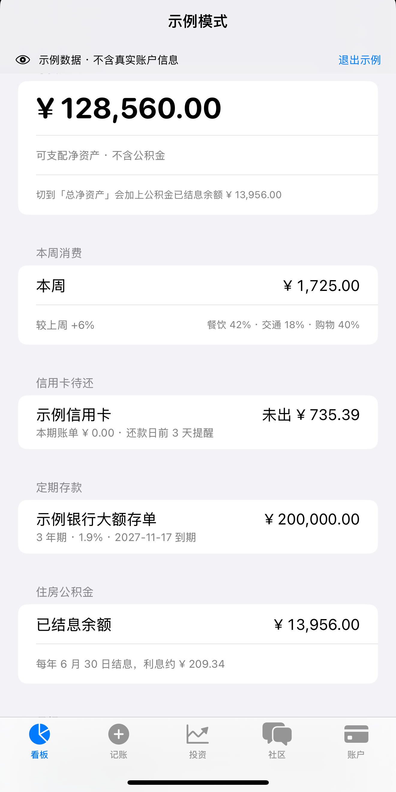
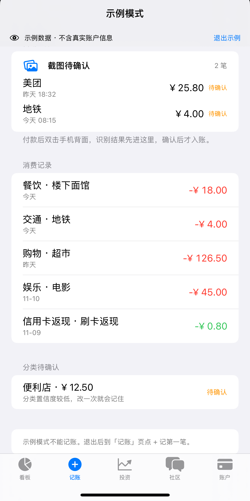
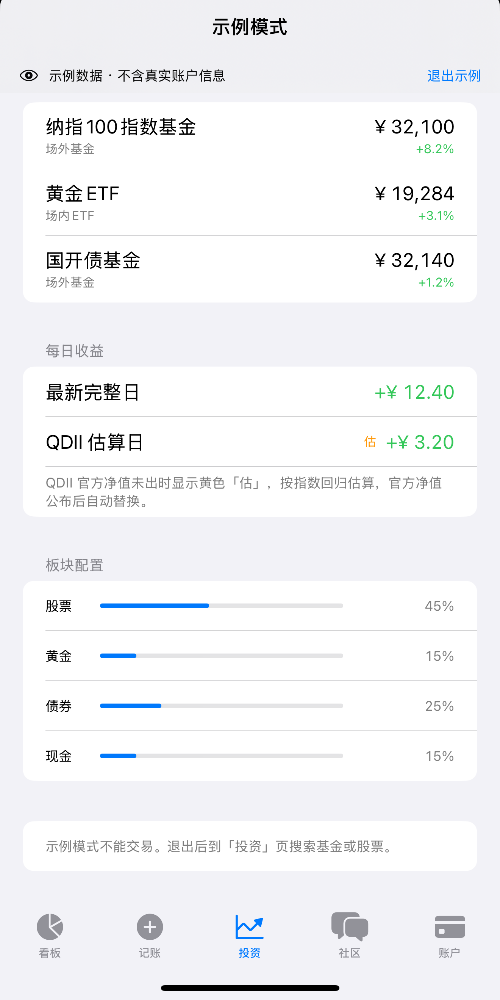
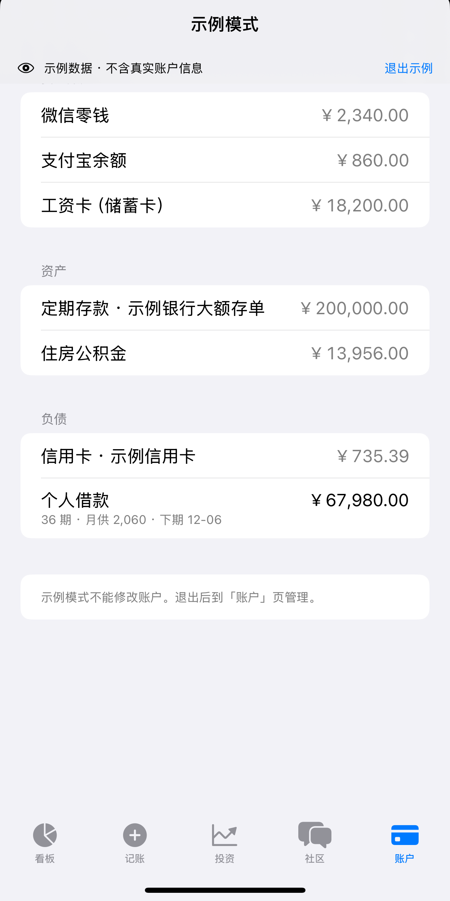
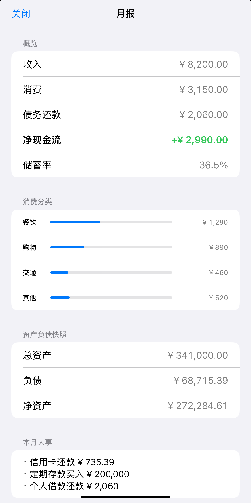

  

<h1 align="center">恒产 · 有恒产者有恒心</h1>

  <strong>只存 iCloud 的个人财务管家</strong> 
  净资产 · 消费 · 工资 · 信用卡 · 定期存款 · 公积金 · 借款 · 投资 · 周报月报

  <a href="https://testflight.apple.com/join/pyH7uEFu"><strong>→ 加入 TestFlight 内测</strong></a>
  &nbsp;·&nbsp;
  <a href="https://hanqingyi123.github.io/hengchan/"><strong>查看完整落地页</strong></a>

  iOS 17+ · iPhone / iPad · 免费内测 
  下面所有截图都来自示例模式，不含任何真实账户信息。

  
  
  

  
  
  

---

## 这是什么

普通人的钱散落在银行卡、微信、支付宝、基金 App、信用卡和公积金账户里，很少有人真正说得清自己的资产、负债和未来。

**恒产想做的，是把这些收拢成一张看得清、管得住、能长期积累的资产负债表。** 不预测市场，不荐股；靠记录、配置和纪律，把财务的确定性一点点建立起来。

名字取自孟子：**有恒产者有恒心。**

## 一个 App 管什么

- **看板**：可支配 / 总净资产、本周消费、信用卡待还、定期存款、公积金
- **记账**：分类、月份筛选、截图自动记账（本地 Vision OCR，无大模型）
- **信用卡**：账单日/还款日、刷卡不扣现金、还款、返现、历史补录
- **定期存款**：大额存单/整存整取等，到期提醒，利息自动记收入
- **公积金**：按工资自动累计，每年 6 月 30 日结息
- **个人借款**：0 息固定月供，手动记还款，还款不计消费
- **投资**：基金/股票/ETF 持仓、板块配置、每日收益、QDII 净值估算
- **报表**：周报、月报、PNG 分享
- **社区**：测试员专属轻社区，提建议、聊资产配置、直接和开发者对话

## 隐私

- 账本数据只保存在你自己的 **iCloud 私有数据库**
- 没有服务器、没有广告、不卖数据
- 开发者看不到你的账本
- 社区内容公开，但和账本数据分开；禁止荐股、带单、收费群和收益承诺

## 这轮内测

大约 **7–14 天**，重点试：

1. 新手引导是否能在 5 分钟内上手
2. 截图自动记账：设置 → 自动记账，一键添加快捷指令，付款时双击背面
3. 信用卡账单、还款、返现
4. 定期存款购买/支取
5. 月报和净资产口径
6. 社区发帖/回复/删除

  

  <a href="https://testflight.apple.com/join/pyH7uEFu"><strong>https://testflight.apple.com/join/pyH7uEFu</strong></a>

## 常见问题

**内测收费吗？**
TestFlight 内测完全免费。正式版的定价也会根据内测用户的反馈来进行调整。

**支持哪些设备？**
iPhone 和 iPad，要求 iOS 17 或更高版本。数据通过你自己的 iCloud 在设备间同步。

**和普通记账 App 有什么区别？**
恒产不只记流水：它把资产、负债、现金流、定期存款、信用卡、公积金、借款和投资放在一张资产负债表里，并提供周报、月报和长期配置视角。

**社区里能聊股票吗？**
可以聊资产配置和投资思路，但禁止荐股、带单、收费群和收益承诺。所有观点仅代表个人，不构成投资建议。

## 链接

- 落地页：https://hanqingyi123.github.io/hengchan/
- TestFlight：https://testflight.apple.com/join/pyH7uEFu
- 反馈邮箱：2315816811@qq.com
- 隐私政策：https://gist.github.com/hanqingyi123/4dcaabc90021d5577a1466ad225da44e

  截图均为示例数据，不含真实账户信息。TestFlight 内测中。

